 

  

 

## ✨ Featured Projects

  <!-- TODO: înlocuiește cu link-ul tău real de Vercel -->
  

 

## 🛠️ Tech Stack

  

 

## 📊 GitHub Activity

  
  

 

## 🐍 Contribution Snake

  <picture>
    <source media="(prefers-color-scheme: dark)" srcset="https://raw.githubusercontent.com/razvanstf31/razvanstf31/output/github-contribution-grid-snake-dark.svg"/>
    <source media="(prefers-color-scheme: light)" srcset="https://raw.githubusercontent.com/razvanstf31/razvanstf31/output/github-contribution-grid-snake.svg"/>
    
  </picture>

