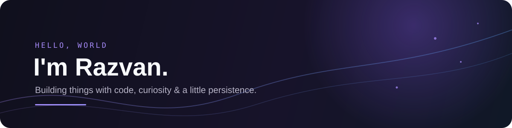
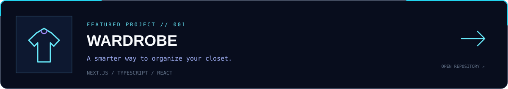

 

# Hey, I'm Razvan 👋

**Computer Science student · Developer · Problem solver**

I enjoy building useful things, exploring how software works, and turning ideas into projects.

---

### `whoami`

- 🎓 Computer Science student at **University of Bucharest — Faculty of Mathematics and Computer Science**
- 💻 Interested in software development, algorithms, and building polished web applications
- 🌱 Currently developing **Wardrobe** and improving my problem-solving skills
- ⚡ I like understanding how things work under the hood — not just making them work

### `currently_building`

### `tech_stack`

### `github_activity`

  

---

*Always learning. Always building.*

# razvanstf31
